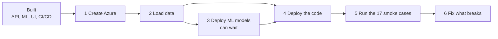
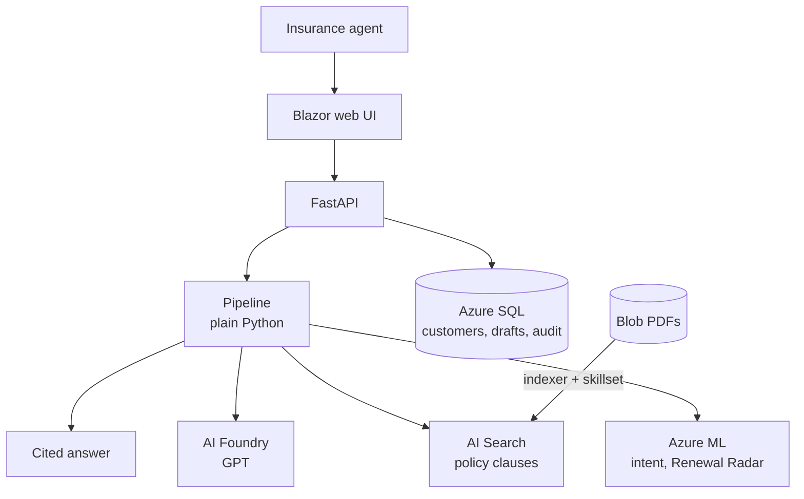
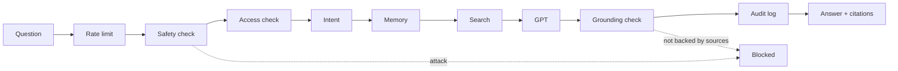
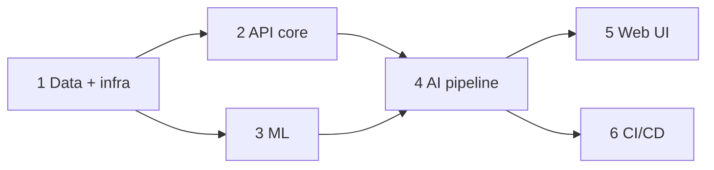
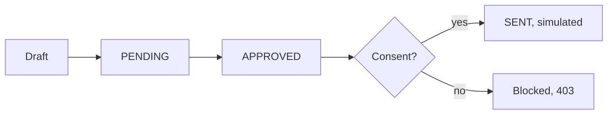
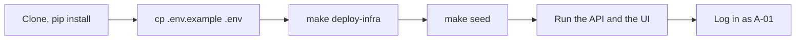
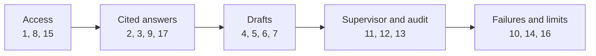

# Building Saathi from scratch in the simplest way


## 1. What is Saathi?

An AI copilot for insurance agents. The agent picks a customer and asks a question. Saathi answers with **citations** from policy documents, drafts renewal messages, and never sends anything without human approval. Every action is logged.

### What is actually pending

All six phases are built. It has **never run on real Azure**, and no one has run the smoke tests yet.



| Guide | Read it to |
|---|---|
| [01 Set up the repo](plans/01-setup-the-repo.md) | run Saathi on your machine |
| [02 Connect to Azure](plans/02-connect-to-azure.md) | deploy it on real Azure, step by step |
| [03 End-to-end smoke tests](plans/03-e2e-smoke-tests.md) | run the 17 test cases by hand, each with a flow diagram |
| [04 Testing we have not done](plans/04-testing-not-done.md) | see exactly what is unproven |

Still open:
- No automated tests exist (the engineer owns testing).
- SQL, Foundry, AI Search, Azure ML and the Bicep have never run for real.
- The UI has compiled but never been opened in a browser.
- The demo passcode `saathi-demo` is public, so do not leave a deployment running unguarded.

## 2. How does it work?



One question goes through these steps, in order. Any step can stop it.



The first architecture picture shows Semantic Kernel. The built pipeline is plain Python in a fixed order, so safety stays in code. The search tool is defined in the MCP style, ready to be wrapped later.

**Azure services** (all created by `infra/`):

| Service | Used for |
|---|---|
| AI Foundry | GPT-4.1-mini answers, text-embedding-3-small search vectors |
| AI Search | hybrid keyword + vector search with the semantic ranker |
| Blob Storage | the policy PDFs, read by the search indexer |
| Azure SQL | agents, customers, policies, sessions, drafts, the audit log |
| Azure ML | two endpoints: intent classifier and Renewal Radar |
| App Service | hosts the API (Python) and the web UI (.NET) |
| Key Vault | the API's secrets |

## 3. How it was built



| Phase | What | Status |
|---|---|---|
| 1 Data + infra | SQL schema, fake data, policy PDFs, Azure resources (Bicep) | built |
| 2 API core | login, customers, drafts, audit log, memory | built |
| 3 ML | intent classifier, Renewal Radar, Azure ML scripts | built |
| 4 AI pipeline | GPT, search, safety, chat, radar, rate limits | built |
| 5 Web UI | login, agent workspace, supervisor screen | built, compiles |
| 6 CI/CD | CI checks, deploy pipeline, smoke and teardown scripts | built, never run |

The full plan is in [`plans/saathi-mvp.md`](plans/saathi-mvp.md).

## 4. What it does

- Answers questions about a customer with citations, and remembers the conversation.
- Shows an agent only their own customers and approved products.
- Drafts a renewal message that must be approved, and re-checks consent before it is "sent".
- Logs every action in a tamper-evident audit log.
- Blocks prompt injection and answers that the sources do not back.
- Ranks customers by renewal likelihood (Renewal Radar).
- Limits each agent to 20 chats and 5 drafts a minute, to cap LLM cost.
- Supervisor screen: pending drafts, audit log with a chain check, usage.



Messages are never really sent. All data is fake.

**The 14 API routes:**

| Route | Who | Does |
|---|---|---|
| `GET /health` | anyone | is it up |
| `POST /auth/login` | anyone | get a token |
| `GET /customers`, `GET /customers/{id}` | agent | own customers, or one customer's policies and history |
| `POST /chat` | agent | a cited answer |
| `GET /sessions/{id}` | agent | the remembered turns |
| `POST /drafts` | agent | create a renewal draft |
| `POST /drafts/{id}/approve`, `.../send` | owner or supervisor | approve, then send (simulated) |
| `GET /drafts?status=` | supervisor | list drafts |
| `GET /radar/worklist` | agent | customers likely to renew |
| `GET /audit`, `GET /audit/verify` | supervisor | the log, and the chain check |
| `GET /usage` | supervisor | chat, blocked and draft counts |

## 5. File structure

Inside a folder, files are grouped by format (`json`, `csv`, `sql`, `scripts`, `pdf`, `bicep`) and the API is grouped by feature.

```text
saathi-from-scratch/
├── README.md
├── Makefile                      short commands: generate, train, deploy-infra, seed
├── .env.example                  every environment variable (names only)
├── .gitignore
│
├── api/                          Python backend
│   ├── requirements.txt
│   ├── startup.sh                installs the ODBC driver, starts the API on Azure
│   └── app/
│       ├── main.py               wires the app and the error format
│       ├── config.py             reads settings from env vars
│       ├── deps.py               settings, DB connection, logged-in agent
│       ├── models/               request and response shapes
│       ├── repos/                all the SQL
│       ├── routers/              the URLs, grouped by feature
│       │   ├── health.py
│       │   ├── access/           login, audit log, usage
│       │   ├── customers/        customers, Renewal Radar worklist
│       │   ├── drafts/           renewal drafts
│       │   └── chat/             questions and sessions
│       ├── services/             the business logic, grouped by feature
│       │   ├── access/           login, tokens, who may see what, audit chain, rate limit
│       │   ├── customers/        renewal state, radar scoring
│       │   ├── drafts/           when a draft may be sent, writing the draft
│       │   ├── chat/             intent, memory, safety checks
│       │   └── ai/               calls to GPT and AI Search
│       └── orchestrator/         the question's journey, and the search tool
│
├── web/Saathi.Web/               .NET Blazor screens
│   ├── Program.cs                reads API_URL, registers the API client and login state
│   ├── Layout/                   title bar, log out
│   ├── Pages/                    login, agent workspace, supervisor screen
│   ├── Components/               chat, customers, radar, drafts, supervisor panels
│   ├── Services/                 ApiClient.cs (every API call), login state, API shapes
│   └── wwwroot/                  styles
│
├── ml/                           the two predictions
│   ├── requirements.txt
│   ├── intent/                   what is the agent asking about
│   ├── radar/                    who is likely to renew
│   └── azureml/
│       ├── scripts/              register and deploy the models on Azure ML
│       └── config/               conda.yml for the endpoints
│
├── data/                         fake data and policy PDFs
│   ├── generate.py               makes all the fake data
│   ├── requirements.txt
│   ├── docs/
│   │   ├── pdf/                  13 policy clause PDFs
│   │   └── json/                 manifest.json, describes each PDF
│   ├── eval/                     gold_questions.json, questions with known answers
│   └── seed/
│       ├── json/                 agents, customers, policies, interactions
│       ├── csv/                  intent train/dev/test, radar training rows
│       ├── sql/                  schema.sql, the Azure SQL tables
│       └── scripts/              load_sql.py, upload_blob.py, create_index.py
│
├── infra/                        creates Azure from code
│   ├── bicep/
│   │   ├── main.bicep            wires everything together
│   │   └── modules/              one file per Azure service
│   └── params/
│       └── parameters.json       names, model versions, region
│
├── scripts/                      smoke_test.sh (check a deploy), teardown.sh (delete everything)
├── public/                       images used in this README
├── plans/                        the plan and four guides: set up, Azure, smoke tests, untested
└── .github/workflows/            ci.yml (checks on PRs), cd.yml (deploy on merge)
```

| Folder | What it is responsible for |
|---|---|
| `api/` | The brain. Checks who is logged in, runs the question through safety, search and GPT, saves drafts and the audit log. |
| `web/` | What the agent sees. It only shows things; every decision is made by the API. |
| `ml/` | The two predictions: intent, and who is likely to renew. Trains them and puts them on Azure ML. |
| `data/` | The fake customers, policies and policy PDFs, and the scripts that load them into Azure. |
| `infra/` | Creates every Azure service from code, so it can be rebuilt or deleted in one command. |
| `scripts/` | Check that a deployed site works, and delete everything after the demo. |
| `plans/` | The plan, plus the four guides below. |
| `.github/` | `ci.yml` lints the Python, builds the UI and scans for secrets on every PR. `cd.yml` deploys when `api/`, `web/` or `scripts/` change on `main`. |

## 6. Quick start

Full steps: [01 Set up the repo](plans/01-setup-the-repo.md) and [02 Connect to Azure](plans/02-connect-to-azure.md).



```bash
git clone https://github.com/aryanc381/saathi-from-scratch.git && cd saathi-from-scratch
pip install -r api/requirements.txt -r data/requirements.txt -r ml/requirements.txt
cp .env.example .env                                          # fill it in
set -a; source .env; set +a
make deploy-infra && make seed                                # creates Azure, loads the data
cd api && python -m uvicorn app.main:app --env-file ../.env   # the API on :8000
cd web/Saathi.Web && API_URL=http://localhost:8000 dotnet run # the UI
```

Log in as `A-01` or `A-02` (agents) or `A-00` (supervisor). The passcode is `saathi-demo`.

Delete everything after the demo: `scripts/teardown.sh saathi-from-scratch-rg`.

## 7. Environment variables

Names only live in [`.env.example`](.env.example). Real values stay in Key Vault, `.env` (gitignored) or GitHub secrets, because this repo is public.

| Group | Variables |
|---|---|
| App | `JWT_SECRET` (32+ characters), `API_URL` (the web UI's address for the API) |
| Mode (mock or Azure) | `LLM_PROVIDER`, `RETRIEVER`, `ML_PROVIDER` |
| AI Foundry | `AZURE_OPENAI_ENDPOINT`, `AZURE_OPENAI_API_KEY`, `AZURE_OPENAI_CHAT_DEPLOYMENT`, `AZURE_OPENAI_EMBED_DEPLOYMENT` |
| AI Search | `AZURE_SEARCH_ENDPOINT`, `AZURE_SEARCH_ADMIN_KEY`, `AZURE_SEARCH_INDEX_NAME` |
| SQL and Blob | `SQL_CONNECTION_STRING`, `AZURE_STORAGE_CONNECTION_STRING` |
| Azure ML endpoints | `RADAR_ENDPOINT_URL`, `RADAR_ENDPOINT_KEY`, `INTENT_ENDPOINT_URL`, `INTENT_ENDPOINT_KEY` |
| Azure ML scripts | `AZURE_SUBSCRIPTION_ID`, `AZURE_RESOURCE_GROUP`, `AZURE_ML_WORKSPACE` |
| Deploy only | `RG`, `SQL_ADMIN_PASSWORD` |
| GitHub secrets | `AZURE_CREDENTIALS`, `AZURE_WEBAPP_NAME_API`, `AZURE_WEBAPP_NAME_WEB` |

For local work set `JWT_SECRET`, `SQL_CONNECTION_STRING` and the three mode switches to `mock` / `local`. GPT, search and ML are then mocked, but the API always needs a SQL database. Put values with spaces or semicolons in double quotes.

## 8. End-to-end smoke tests

Run by a person, on the deployed site. All 17 cases, each with a flow diagram, are in [03 End-to-end smoke tests](plans/03-e2e-smoke-tests.md).



| # | Case | Expect |
|---|---|---|
| 1 | Log in | token, or a clear error |
| 2, 3 | Ask a question, then a follow-up | cited answers |
| 4, 5, 6 | Draft, send too early, approve and send | PENDING, 409, then sent (simulated) |
| 7 | Send to a customer with no consent | 403 |
| 8 | Open another agent's customer | 403 |
| 9, 17 | Prompt injection, and a draft typed in chat | blocked, and a pointer to the button |
| 10 | Bad input | 400 |
| 11, 12, 13 | Supervisor screens, audit check, a tampered row | lists load, valid, then broken at that row |
| 14 | Azure is down | 503, no made-up answer |
| 15 | Live health | 200 |
| 16 | 21 questions in a minute | 429 on the 21st |
