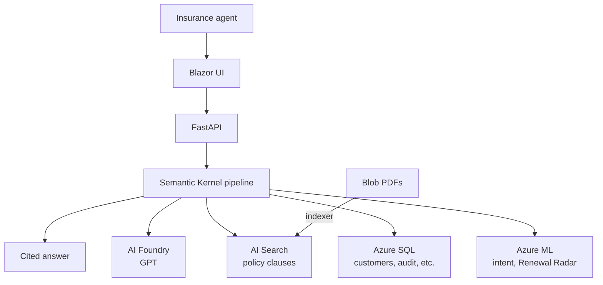
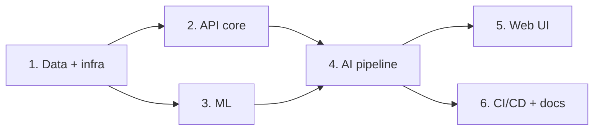
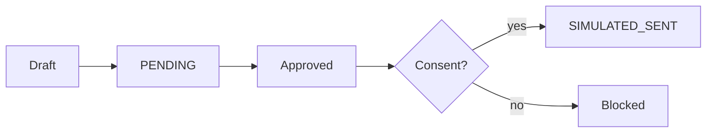

# Building Saathi from scratch in the simplest way


## 1. What is Saathi?

An AI copilot for insurance agents. The agent picks a customer and asks a question. Saathi answers with **citations** from policy documents, drafts renewal messages, and never sends anything without human approval. Every action is logged.

## 2. How does it work?



One question goes through these steps, in order:
**safety check → access check → intent → memory → search → GPT → grounding check → audit log.**

## 3. How we are building it



| Phase | What |
|---|---|
| 1. Data + infra | SQL schema, fake data, policy PDFs, Azure resources (Bicep) |
| 2. API core | Login, customers, drafts, audit log, memory |
| 3. ML | Intent classifier and Renewal Radar |
| 4. AI pipeline | GPT, search, safety checks, chat |
| 5. Web UI | Agent workspace and supervisor console |
| 6. CI/CD + docs | Tests on every PR, deploy to Azure |

The full plan is in [`plans/saathi-mvp.md`](plans/saathi-mvp.md).

## 4. What it does

- Answers questions about a customer with citations.
- Remembers the conversation, so follow-ups work.
- Understands the intent of each question.
- Shows an agent only their own customers.
- Drafts a renewal message that must be approved before it is "sent".
- Logs every action in a tamper-evident audit log.
- Blocks prompt-injection and unsupported claims.
- Ranks customers by renewal likelihood (Renewal Radar).
- Supervisor console: pending drafts, audit log, usage.



Messages are never really sent. All data is fake.

## 5. How to set it up

You need: Python 3.12, an Azure subscription with the Azure CLI, and the ODBC Driver 18 for SQL Server.

```bash
git clone https://github.com/aryanc381/saathi-from-scratch.git
cd saathi-from-scratch
pip install -r data/requirements.txt
cp .env.example .env        # then fill it in
make generate               # fake data + policy PDFs
az login
az group create -n <rg> -l centralus
set -a; source .env; set +a
make deploy-infra           # creates all Azure resources
make seed                   # loads SQL, uploads PDFs, builds the search index
```

Before `make seed`, copy the connection strings and keys from the deployed resources into `.env`, and add your IP to the SQL firewall.

Running the API and UI comes with phases 2 to 5.

## 6. Environment variables

Names only live in [`.env.example`](.env.example). Real values stay in Key Vault or GitHub secrets, because this repo is public.

| Group | Variables |
|---|---|
| App | `APP_ENV`, `JWT_SECRET`, `API_URL` |
| Mode (mock or Azure) | `LLM_PROVIDER`, `RETRIEVER`, `ML_PROVIDER` |
| AI Foundry | `AZURE_OPENAI_ENDPOINT`, `AZURE_OPENAI_API_KEY`, `AZURE_OPENAI_CHAT_DEPLOYMENT`, `AZURE_OPENAI_EMBED_DEPLOYMENT` |
| AI Search | `AZURE_SEARCH_ENDPOINT`, `AZURE_SEARCH_ADMIN_KEY`, `AZURE_SEARCH_INDEX_NAME` |
| SQL | `SQL_CONNECTION_STRING` |
| Blob | `AZURE_STORAGE_CONNECTION_STRING` |
| Azure ML | `RADAR_ENDPOINT_URL`, `RADAR_ENDPOINT_KEY`, `INTENT_ENDPOINT_URL`, `INTENT_ENDPOINT_KEY` |
| Deploy only | `RG`, `SQL_ADMIN_PASSWORD`, plus GitHub secrets `AZURE_CREDENTIALS`, `AZURE_WEBAPP_NAME_API`, `AZURE_WEBAPP_NAME_WEB` |

For local work, set `APP_ENV=local`, a `JWT_SECRET`, and the three mode switches to `mock` / `local`. No Azure needed.

## 7. End-to-end smoke tests

Run by a person, not by a script. Seed: agent 1 owns C-204, C-311, C-205, C-450; agent 2 owns C-118 and C-999; C-205 has no consent.

| # | Do this | Expect |
|---|---|---|
| 1 | Log in as agent 1 | Token, workspace opens |
| 2 | Pick C-204, ask "Compare Silver and Gold" | Answer with citations |
| 3 | Ask "and Platinum?" | Answered without repeating the customer |
| 4 | Request a renewal draft | PENDING, Send disabled |
| 5 | Send before approving | 409 error |
| 6 | Approve, then send | APPROVED, then SIMULATED_SENT |
| 7 | Approve and send for C-205 (no consent) | 403, not sent |
| 8 | Agent 1 opens C-118 | 403, no data |
| 9 | Send a prompt-injection question | Blocked, with a reason |
| 10 | Send an empty, then a 1000+ character question | 400 each |
| 11 | As supervisor, open worklist, drafts, usage | Lists load |
| 12 | Verify the audit chain | Valid |
| 13 | Edit one audit row in SQL, verify again | Invalid, shows the broken row |
| 14 | Turn off Foundry or Search, ask a question | 503, no unsourced answer |
| 15 | Open `/health` on the live Azure URL | 200 |
