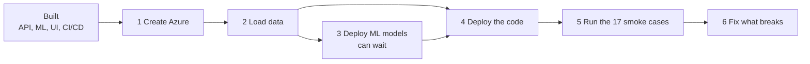
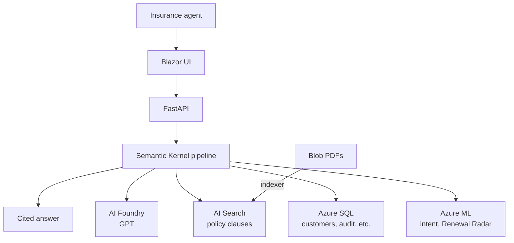
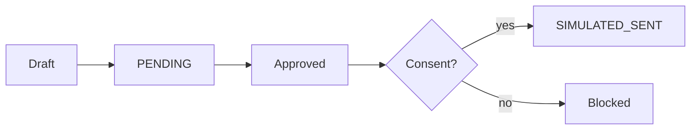

# Building Saathi from scratch in the simplest way


## 1. What is Saathi?

An AI copilot for insurance agents. The agent picks a customer and asks a question. Saathi answers with **citations** from policy documents, drafts renewal messages, and never sends anything without human approval. Every action is logged.

### What is actually pending

All six phases are built. It has **never run on real Azure**, and no one has run the smoke tests yet.



| Guide | Read it to |
|---|---|
| [01 Set up the repo](plans/01-setup-the-repo.md) | run Saathi on your machine |
| [02 Connect to Azure](plans/02-connect-to-azure.md) | deploy it on real Azure, step by step |
| [03 End-to-end smoke tests](plans/03-e2e-smoke-tests.md) | run the 17 test cases by hand, each with a flow diagram |
| [04 Testing we have not done](plans/04-testing-not-done.md) | see exactly what is unproven |

Still open:
- No automated tests exist (the engineer owns testing).
- SQL, Foundry, AI Search, Azure ML and the Bicep have never run for real.
- The UI has compiled but never been opened in a browser.
- The demo passcode `saathi-demo` is public, so do not leave a deployment running unguarded.

## 2. How does it work?



One question goes through these steps, in order:
**safety check → access check → intent → memory → search → GPT → grounding check → audit log.**

## 3. How we are building it


| Phase | What |
|---|---|
| 1. Data + infra | SQL schema, fake data, policy PDFs, Azure resources (Bicep) |
| 2. API core | Login, customers, drafts, audit log, memory |
| 3. ML | Intent classifier and Renewal Radar |
| 4. AI pipeline | GPT, search, safety checks, chat |
| 5. Web UI | Agent workspace and supervisor console |
| 6. CI/CD | Checks on every PR, deploy to Azure |

The full plan is in [`plans/saathi-mvp.md`](plans/saathi-mvp.md).

## 4. What it does

- Answers questions about a customer with citations.
- Remembers the conversation, so follow-ups work.
- Understands the intent of each question.
- Shows an agent only their own customers.
- Drafts a renewal message that must be approved before it is "sent".
- Logs every action in a tamper-evident audit log.
- Blocks prompt-injection and unsupported claims.
- Ranks customers by renewal likelihood (Renewal Radar).
- Supervisor console: pending drafts, audit log, usage.



Messages are never really sent. All data is fake.

## 5. File structure

Inside a folder, files are grouped by format (`json`, `csv`, `sql`, `scripts`, `pdf`, `bicep`) and the API is grouped by feature.

```text
saathi-from-scratch/
├── README.md
├── Makefile                      short commands: generate, train, deploy-infra, seed
├── .env.example                  every environment variable (names only)
├── .gitignore
│
├── api/                          Python backend
│   ├── requirements.txt
│   ├── startup.sh                starts the API on Azure
│   └── app/
│       ├── main.py               wires the app and the error format
│       ├── config.py             reads settings from env vars
│       ├── deps.py               settings, DB connection, logged-in agent
│       ├── models/               request and response shapes
│       ├── repos/                all the SQL
│       ├── routers/              the URLs, grouped by feature
│       │   ├── health.py
│       │   ├── access/           login, audit log, usage
│       │   ├── customers/        customers, Renewal Radar worklist
│       │   ├── drafts/           renewal drafts
│       │   └── chat/             questions and sessions
│       ├── services/             the business logic, grouped by feature
│       │   ├── access/           login, tokens, who may see what, audit chain
│       │   ├── customers/        renewal state, radar scoring
│       │   ├── drafts/           when a draft may be sent, writing the draft
│       │   ├── chat/             intent, memory, safety checks
│       │   └── ai/               calls to GPT and AI Search
│       └── orchestrator/         the question's journey, and the search tool
│
├── web/Saathi.Web/               .NET Blazor screens
│   ├── Program.cs                reads API_URL, registers the API client and login state
│   ├── Layout/                   title bar, log out
│   ├── Pages/                    login, agent workspace, supervisor screen
│   ├── Components/               chat, customers, radar, drafts, supervisor panels
│   ├── Services/                 ApiClient.cs (every API call), login state, API shapes
│   └── wwwroot/                  styles
│
├── ml/                           the two predictions
│   ├── requirements.txt
│   ├── intent/                   what is the agent asking about
│   ├── radar/                    who is likely to renew
│   └── azureml/
│       ├── scripts/              register and deploy the models on Azure ML
│       └── config/               conda.yml for the endpoints
│
├── data/                         fake data and policy PDFs
│   ├── generate.py               makes all the fake data
│   ├── requirements.txt
│   ├── docs/
│   │   ├── pdf/                  13 policy clause PDFs
│   │   └── json/                 manifest.json, describes each PDF
│   ├── eval/                     gold_questions.json, questions with known answers
│   └── seed/
│       ├── json/                 agents, customers, policies, interactions
│       ├── csv/                  intent train/dev/test, radar training rows
│       ├── sql/                  schema.sql, the Azure SQL tables
│       └── scripts/              load_sql.py, upload_blob.py, create_index.py
│
├── infra/                        creates Azure from code
│   ├── bicep/
│   │   ├── main.bicep            wires everything together
│   │   └── modules/              one file per Azure service
│   └── params/
│       └── parameters.json       names, model versions, region
│
├── scripts/                      smoke_test.sh (check a deploy), teardown.sh (delete everything)
├── public/                       images used in this README
├── plans/                        the approved plan and the four guides (set up, Azure, smoke tests, untested)
└── .github/workflows/            ci.yml (checks on PRs), cd.yml (deploy on merge)
```

| Folder | What it is responsible for |
|---|---|
| `api/` | The brain. Checks who is logged in, runs the question through safety, search and GPT, saves drafts and the audit log. Grouped by feature: access, customers, drafts, chat. |
| `web/` | What the agent sees. Login, chat with citations, customers, the radar, drafts, and the supervisor screen. It only shows things; every decision is made by the API. |
| `ml/` | The two predictions: what the agent is asking about (intent), and who is likely to renew (Renewal Radar). Trains them and puts them on Azure ML. |
| `data/` | The fake customers, policies and policy PDFs, and the scripts that put them into Azure SQL, Blob and Search. |
| `infra/` | Creates every Azure service from code, so the whole setup can be rebuilt or deleted in one command. |
| `scripts/` | Two helpers: check that a deployed site works, and delete everything after the demo. |
| `public/` | Pictures only. |
| `plans/` | The plan we agreed before writing code, plus four guides: set up, connect to Azure, smoke tests, and what is untested. |
| `.github/` | `ci.yml` lints the Python, builds the UI and scans for secrets on every pull request. `cd.yml` deploys to Azure when the api, web or scripts change on `main`. |

## 6. How to set it up

You need: Python 3.12, an Azure subscription with the Azure CLI, and the ODBC Driver 18 for SQL Server.

```bash
git clone https://github.com/aryanc381/saathi-from-scratch.git
cd saathi-from-scratch
pip install -r data/requirements.txt
cp .env.example .env        # then fill it in
make generate               # fake data + policy PDFs
az login
az group create -n saathi-from-scratch-rg -l centralus
set -a; source .env; set +a
make deploy-infra           # creates all Azure resources
make seed                   # loads SQL, uploads PDFs, builds the search index
```

### Train and deploy the ML models

```bash
pip install -r ml/requirements.txt
make train                  # trains the intent classifier and the Renewal Radar model
python ml/azureml/scripts/register.py   # needs AZURE_SUBSCRIPTION_ID, AZURE_RESOURCE_GROUP, AZURE_ML_WORKSPACE
python ml/azureml/scripts/deploy.py     # creates the two endpoints; they cost money while they run
```

Copy each endpoint's URL and key into `.env` (`INTENT_ENDPOINT_URL`, `RADAR_ENDPOINT_URL`, and their keys) and set `ML_PROVIDER=azure`. Delete the endpoints after the demo.

Set `RG=saathi-from-scratch-rg` in `.env`. This project uses its own resource group, separate from any earlier one.

Before `make seed`, copy the connection strings and keys from the deployed resources into `.env`, and add your IP to the SQL firewall.

### Run the API

Put `JWT_SECRET` (32+ characters), `SQL_CONNECTION_STRING` and the three mode switches in `.env`. With `LLM_PROVIDER=mock`, `RETRIEVER=local` and `ML_PROVIDER=local` nothing else is needed. The machine also needs the ODBC Driver 18 for SQL Server.

```bash
pip install -r api/requirements.txt
cd api
uvicorn app.main:app --env-file ../.env
```

Open http://localhost:8000/docs to see every route.

### Run the web UI

```bash
cd web/Saathi.Web
API_URL=http://localhost:8000 dotnet run      # needs the .NET 10 SDK
```

Open the address it prints, then log in as `A-01` (agent) or `A-00` (supervisor) with the passcode `saathi-demo`.

### Deploy with GitHub Actions

Run `make deploy-infra` and `make seed` once, then add three GitHub secrets (Settings, Secrets and variables, Actions):

| Secret | Value |
|---|---|
| `AZURE_CREDENTIALS` | the JSON from `az ad sp create-for-rbac --name saathi-cd --role contributor --scopes /subscriptions/<id>/resourceGroups/saathi-from-scratch-rg --sdk-auth` |
| `AZURE_WEBAPP_NAME_API` | the API app's name (the `apiUrl` output of the deploy, without `https://` and `.azurewebsites.net`) |
| `AZURE_WEBAPP_NAME_WEB` | the web app's name (same, from `webUrl`) |

After that, `cd.yml` deploys on every merge that touches `api/`, `web/` or `scripts/`, and can also be run by hand from the Actions tab. Until the secrets exist, CD fails.

### Delete everything after the demo

```bash
scripts/teardown.sh saathi-from-scratch-rg    # asks you to type the group name first
```

## 7. Environment variables

Names only live in [`.env.example`](.env.example). Real values stay in Key Vault or GitHub secrets, because this repo is public.

| Group | Variables |
|---|---|
| App | `JWT_SECRET`, `API_URL` (the web UI's address for the API) |
| Mode (mock or Azure) | `LLM_PROVIDER`, `RETRIEVER`, `ML_PROVIDER` |
| AI Foundry | `AZURE_OPENAI_ENDPOINT`, `AZURE_OPENAI_API_KEY`, `AZURE_OPENAI_CHAT_DEPLOYMENT`, `AZURE_OPENAI_EMBED_DEPLOYMENT` |
| AI Search | `AZURE_SEARCH_ENDPOINT`, `AZURE_SEARCH_ADMIN_KEY`, `AZURE_SEARCH_INDEX_NAME` |
| SQL | `SQL_CONNECTION_STRING` |
| Blob | `AZURE_STORAGE_CONNECTION_STRING` |
| Azure ML endpoints | `RADAR_ENDPOINT_URL`, `RADAR_ENDPOINT_KEY`, `INTENT_ENDPOINT_URL`, `INTENT_ENDPOINT_KEY` |
| Azure ML scripts | `AZURE_SUBSCRIPTION_ID`, `AZURE_RESOURCE_GROUP`, `AZURE_ML_WORKSPACE` |
| Deploy only | `RG`, `SQL_ADMIN_PASSWORD`, plus GitHub secrets `AZURE_CREDENTIALS`, `AZURE_WEBAPP_NAME_API`, `AZURE_WEBAPP_NAME_WEB` |

For local work, set a `JWT_SECRET`, a `SQL_CONNECTION_STRING`, and the three mode switches to `mock` / `local`. The AI services (GPT, search, ML) are mocked, but the API always needs a SQL database.

## 8. End-to-end smoke tests

Run by a person, not by a script. Every demo agent's passcode is `saathi-demo`. Seed: agent 1 owns C-204, C-311, C-205, C-450; agent 2 owns C-118 and C-999; C-205 has no consent.

| # | Do this | Expect |
|---|---|---|
| 1 | Log in as agent 1 | Token, workspace opens |
| 2 | Pick C-204, ask "Compare Silver and Gold" | Answer with citations |
| 3 | Ask "and Platinum?" | Answered without repeating the customer |
| 4 | Request a renewal draft | PENDING, Send disabled |
| 5 | Send before approving | 409 error |
| 6 | Approve, then send | APPROVED, then SIMULATED_SENT |
| 7 | Approve and send for C-205 (no consent) | 403, not sent |
| 8 | Agent 1 opens C-118 | 403, no data |
| 9 | Send a prompt-injection question | Blocked, with a reason |
| 10 | Send an empty, then a 1000+ character question | 400 each |
| 11 | As supervisor, open worklist, drafts, usage | Lists load |
| 12 | Verify the audit chain | Valid |
| 13 | Edit one audit row in SQL, verify again | Invalid, shows the broken row |
| 14 | Turn off Foundry or Search, ask a question | 503, no unsourced answer |
| 15 | Open `/health` on the live Azure URL | 200 |
