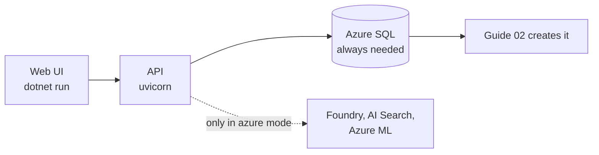
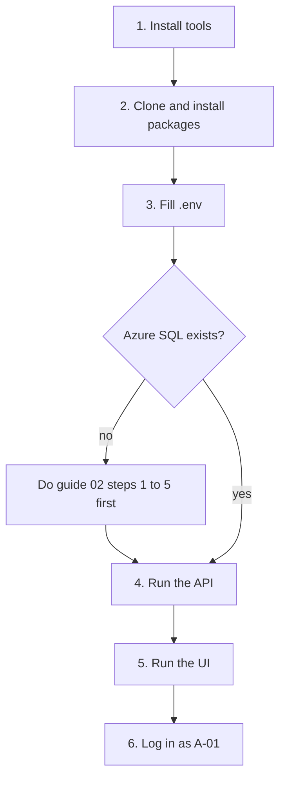
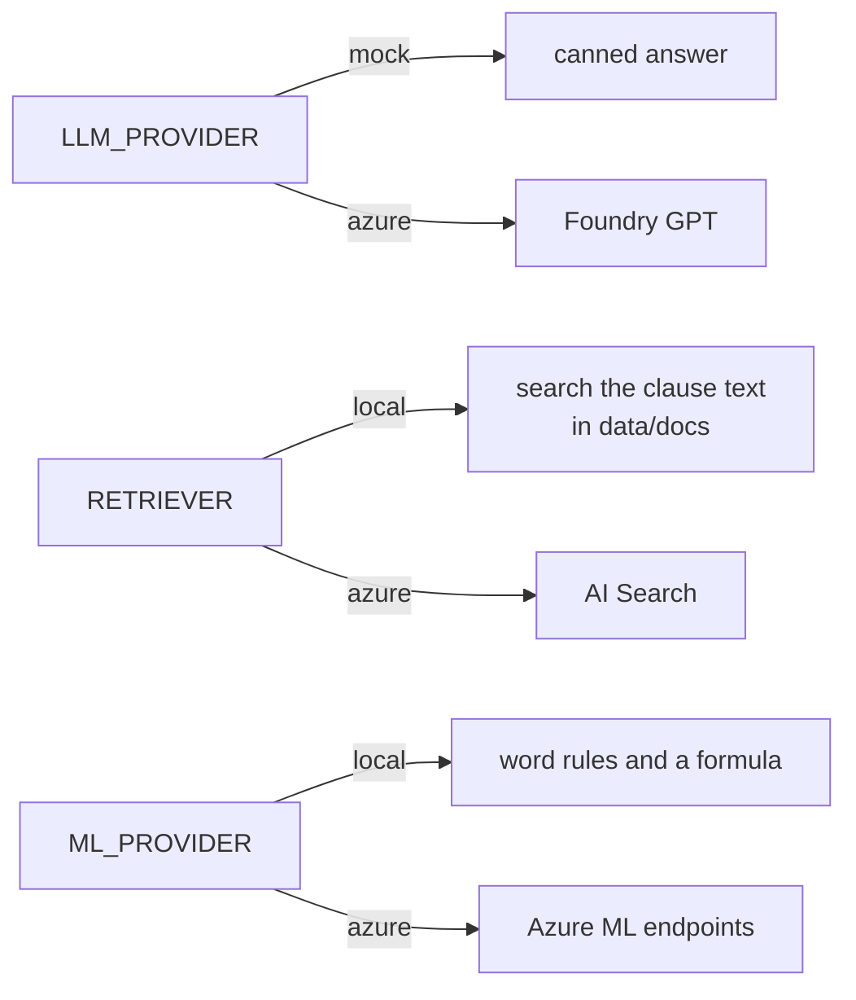

# 01. Set up the repo

Get Saathi running on your machine. About 20 minutes, plus the Azure SQL database from guide 02.

## What you need

| Tool | Version | Needed for |
|---|---|---|
| Python | 3.12 | API, data scripts, ML |
| .NET SDK | 10 | the web UI |
| ODBC Driver 18 for SQL Server | 18 | the API talking to SQL |
| Azure CLI | latest | everything on Azure |
| git | any | cloning |

On macOS: `brew tap microsoft/mssql-release https://github.com/Microsoft/homebrew-mssql-release` then `brew install msodbcsql18`.

## What needs what



There is no local SQL Server (no Docker). The API always needs the Azure SQL database, even in mock mode.

## Steps



### 1 to 2. Install and clone

```bash
git clone https://github.com/aryanc381/saathi-from-scratch.git
cd saathi-from-scratch
python3 -m venv .venv && source .venv/bin/activate
pip install -r api/requirements.txt -r data/requirements.txt -r ml/requirements.txt
```

### 3. Fill `.env`

```bash
cp .env.example .env
python3 -c "import secrets; print(secrets.token_hex(32))"    # use this as JWT_SECRET
```

The smallest working `.env` (no Azure AI needed):

```text
JWT_SECRET=<the 64 characters you just made>
SQL_CONNECTION_STRING="Driver={ODBC Driver 18 for SQL Server};Server=tcp:<server>,1433;Database=saathifs;Uid=saathiadmin;Pwd=<password>;Encrypt=yes;TrustServerCertificate=no;"
LLM_PROVIDER=mock
RETRIEVER=local
ML_PROVIDER=local
```

Your IP must be allowed through the SQL firewall (guide 02, step 6).

### 4. Run the API

```bash
cd api
python -m uvicorn app.main:app --env-file ../.env
```

Open http://localhost:8000/docs. `GET /health` should return `{"status": "ok"}`.

### 5. Run the UI

```bash
cd web/Saathi.Web
API_URL=http://localhost:8000 dotnet run
```

Open the address it prints.

### 6. Log in

| Who | Agent id | Passcode |
|---|---|---|
| Agent | `A-01` | `saathi-demo` |
| Agent | `A-02` | `saathi-demo` |
| Supervisor | `A-00` | `saathi-demo` |

## The three mode switches



Mock mode is for working offline. The real behaviour is only seen in `azure` mode.

## Useful commands

| Command | Does |
|---|---|
| `make generate` | rebuilds the fake data (already committed, same result every time) |
| `make train` | trains the two ML models into `ml/artifacts` (only needed before guide 02, step 9) |
| `make deploy-infra` | creates Azure (guide 02) |
| `make seed` | loads SQL, Blob and Search (guide 02) |

## If something fails

| You see | Because | Fix |
|---|---|---|
| `KeyError: 'JWT_SECRET'` or similar on start | a variable is missing | add it to `.env` |
| `JWT_SECRET must be at least 32 characters` | too short | use the command above |
| `LLM_PROVIDER must be one of ...` | typo in a mode switch | `mock` or `azure` |
| `Can't open lib 'ODBC Driver 18...'` | driver not installed | install it (see above) |
| Login timeout or `Cannot open server` | SQL firewall blocks you | add your IP (guide 02, step 6) |
| `source .env` prints errors | a value with spaces or `;` is not in quotes | wrap it in double quotes |
| UI says `Cannot reach the API` | API not running, or wrong `API_URL` | start the API, check the URL |
| Refreshing the UI logs you out | expected: login lives in the browser session only | log in again |

Next: [02 Connect to Azure](02-connect-to-azure.md).
