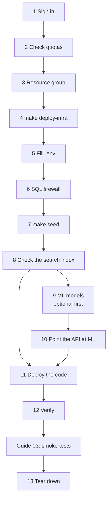
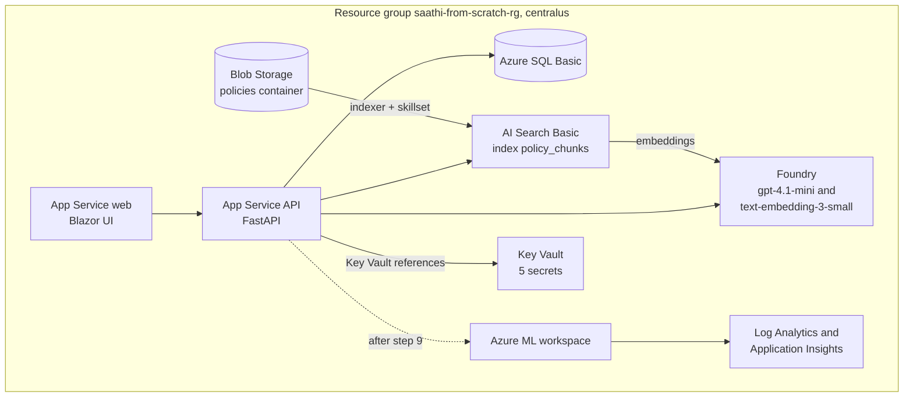
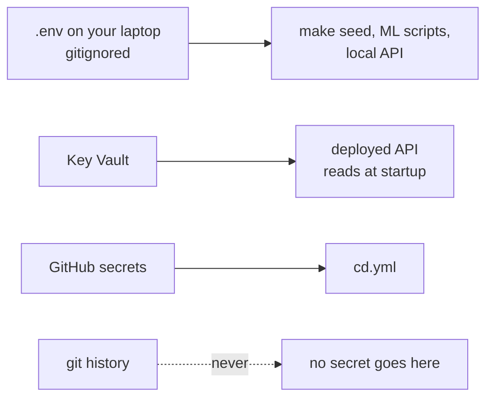
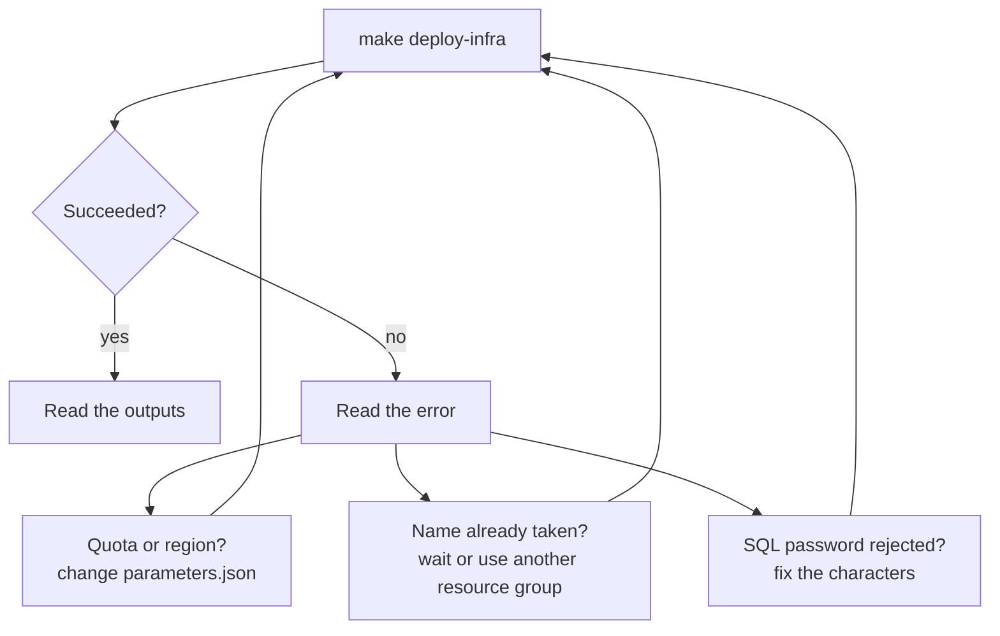
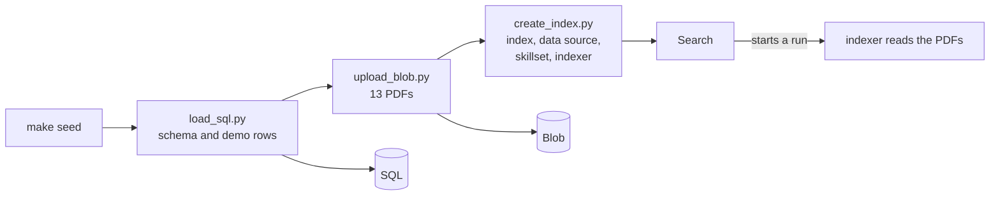
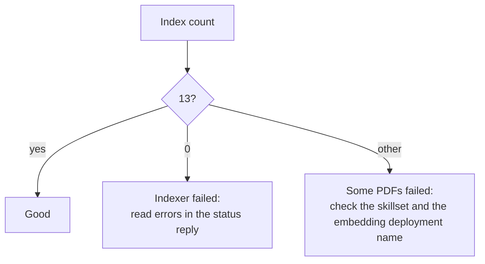
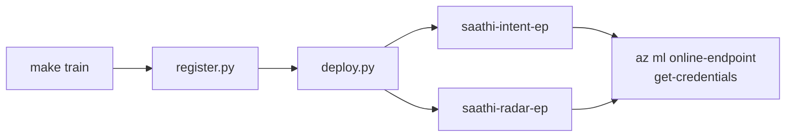
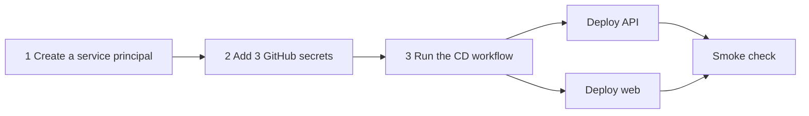
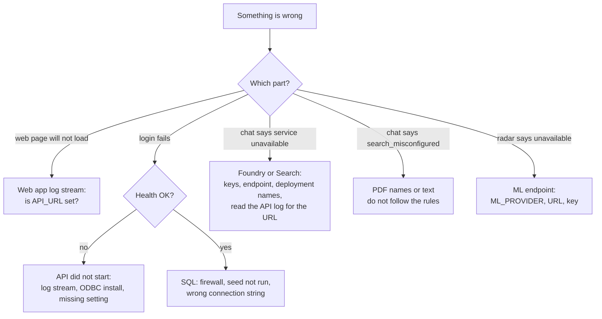

# 02. Connect Saathi to real Azure

The first real run. About 1 to 2 hours, mostly waiting for Azure. Nothing here has been tried on real Azure yet, so expect to fix small things. Write them down.

## The journey



Steps 9 and 10 can wait. The API works with `ML_PROVIDER=local` until you do them.

## What gets created



Names get a 6-character suffix, for example `saathifs-api-x7k2pq`. You read them from the deploy output in step 4.

## Where secrets live



---

## Steps

### 1. Sign in

```bash
az login
az account set --subscription "<your subscription id>"
az extension add --name ml
```

### 2. Check quotas

In the Azure AI Foundry portal, Management, Quota, region **Central US**. You need:

| Item | Needed |
|---|---|
| `gpt-4.1-mini`, GlobalStandard | 50K tokens per minute |
| `text-embedding-3-small`, Standard | 50K tokens per minute |
| Azure ML, `Standard_D2a_v4` | 2 instances of 2 cores (step 9) |

If a quota is missing, change the region or the numbers in `infra/params/parameters.json` before step 4.

### 3. Create the resource group

```bash
export RG=saathi-from-scratch-rg
az group create --name $RG --location centralus
```

### 4. Create the resources

In `.env` set `RG`, `SQL_ADMIN_PASSWORD` and `JWT_SECRET` (the JWT_SECRET is 32+ characters). The SQL password needs upper case, lower case, a digit and a symbol, but **no** `;`, `=`, `{` or `}`, because it goes into a connection string.

```bash
set -a; source .env; set +a
make deploy-infra          # 10 to 15 minutes
```

Then read the names:

```bash
az deployment group show --resource-group $RG --name main --query properties.outputs --output yaml
```

| Output | You will use it as |
|---|---|
| `apiUrl`, `webUrl` | the two sites |
| `foundryEndpoint` | `AZURE_OPENAI_ENDPOINT`; the name is the part before `.openai.azure.com` |
| `searchEndpoint` | `AZURE_SEARCH_ENDPOINT`; the name is the part before `.search.windows.net` |
| `sqlServer` | in the SQL connection string; the server name is the part before `.database.windows.net` |
| `storageAccount`, `mlWorkspace` | in the commands below |



### 5. Fill `.env`

| Variable | Value / command |
|---|---|
| `AZURE_OPENAI_ENDPOINT` | the `foundryEndpoint` output |
| `AZURE_OPENAI_API_KEY` | `az cognitiveservices account keys list --resource-group $RG --name <foundry name> --query key1 --output tsv` |
| `AZURE_OPENAI_CHAT_DEPLOYMENT` | `gpt-4.1-mini` |
| `AZURE_OPENAI_EMBED_DEPLOYMENT` | `text-embedding-3-small` |
| `AZURE_SEARCH_ENDPOINT` | the `searchEndpoint` output |
| `AZURE_SEARCH_ADMIN_KEY` | `az search admin-key show --resource-group $RG --service-name <search name> --query primaryKey --output tsv` |
| `AZURE_SEARCH_INDEX_NAME` | `policy_chunks` |
| `AZURE_STORAGE_CONNECTION_STRING` | `az storage account show-connection-string --resource-group $RG --name <storageAccount> --query connectionString --output tsv` |
| `SQL_CONNECTION_STRING` | `"Driver={ODBC Driver 18 for SQL Server};Server=tcp:<sqlServer>,1433;Database=saathifs;Uid=saathiadmin;Pwd=<SQL_ADMIN_PASSWORD>;Encrypt=yes;TrustServerCertificate=no;"` |
| `AZURE_SUBSCRIPTION_ID` | `az account show --query id --output tsv` |
| `AZURE_RESOURCE_GROUP` | `saathi-from-scratch-rg` |
| `AZURE_ML_WORKSPACE` | the `mlWorkspace` output |

Set the three mode switches to `azure`, `azure` and `local` for now. Never commit `.env`.

### 6. Open the SQL firewall for your IP

```bash
MY_IP=$(curl -s https://api.ipify.org)
az sql server firewall-rule create --resource-group $RG --server <sql server name> \
  --name my-ip --start-ip-address $MY_IP --end-ip-address $MY_IP
```

### 7. Load the data

```bash
pip install -r data/requirements.txt
set -a; source .env; set +a
make seed
```



Expect SQL: 3 agents, 6 customers, 6 policies, 18 interactions. Blob container `policies`: 13 PDFs.

### 8. Check the search index

```bash
curl -s -H "api-key: $AZURE_SEARCH_ADMIN_KEY" \
  "$AZURE_SEARCH_ENDPOINT/indexers/policies-indexer/status?api-version=2024-07-01"
curl -s -H "api-key: $AZURE_SEARCH_ADMIN_KEY" \
  "$AZURE_SEARCH_ENDPOINT/indexes/policy_chunks/docs/\$count?api-version=2024-07-01"
```

The status should end `success`, and the count should be **13**. If the count is 0, look at the errors in the status reply.



### 9. ML models (can wait)

```bash
pip install -r ml/requirements.txt
make train
python ml/azureml/scripts/register.py
python ml/azureml/scripts/deploy.py      # 10 to 20 minutes per endpoint; they cost money while running
```



Get each endpoint's URL and key:

```bash
az ml online-endpoint show --name saathi-intent-ep --resource-group $RG --workspace-name $AZURE_ML_WORKSPACE --query scoring_uri --output tsv
az ml online-endpoint get-credentials --name saathi-intent-ep --resource-group $RG --workspace-name $AZURE_ML_WORKSPACE
```

Repeat for `saathi-radar-ep`. Try the intent endpoint once:

```bash
echo '{"text": "when does my policy renew?"}' > /tmp/request.json
az ml online-endpoint invoke --name saathi-intent-ep --resource-group $RG --workspace-name $AZURE_ML_WORKSPACE --request-file /tmp/request.json
```

You should get `{"label": "renewal", "confidence": ...}`.

### 10. Point the API at the ML endpoints

The deployed API starts with `ML_PROVIDER=local`. After step 9, switch it:

```bash
az webapp config appsettings set --resource-group $RG --name <api app name> --settings \
  ML_PROVIDER=azure INTENT_ENDPOINT_URL=<url> INTENT_ENDPOINT_KEY=<key> \
  RADAR_ENDPOINT_URL=<url> RADAR_ENDPOINT_KEY=<key>
```

### 11. Deploy the code



```bash
az ad sp create-for-rbac --name saathi-cd --role contributor \
  --scopes /subscriptions/<subscription id>/resourceGroups/$RG --sdk-auth > credentials.json
gh secret set AZURE_CREDENTIALS --repo aryanc381/saathi-from-scratch < credentials.json
gh secret set AZURE_WEBAPP_NAME_API --repo aryanc381/saathi-from-scratch --body "<api app name>"
gh secret set AZURE_WEBAPP_NAME_WEB --repo aryanc381/saathi-from-scratch --body "<web app name>"
rm credentials.json
gh workflow run CD --repo aryanc381/saathi-from-scratch
gh run watch --repo aryanc381/saathi-from-scratch
```

The first start of the API takes 1 to 2 minutes, because `startup.sh` installs the ODBC driver.

### 12. Verify

```bash
scripts/smoke_test.sh <apiUrl> <webUrl>
```

It checks the API health, a demo login (which proves SQL works) and the web login page. Then do [guide 03](03-e2e-smoke-tests.md).

### 13. Tear down

```bash
scripts/teardown.sh saathi-from-scratch-rg     # asks you to type the group name
az ad sp delete --id <the appId in credentials.json>
```

Also delete the three GitHub secrets. The ML endpoints and AI Search Basic are the parts that cost the most while idle.

---

## When the deployed site misbehaves



| Symptom | Look at |
|---|---|
| API will not start | `az webapp log tail --resource-group $RG --name <api app name>` |
| `KeyError` in the log | an app setting is missing |
| `Can't open lib 'ODBC Driver 18'` | the startup install failed; check the log for `apt-get` |
| Key Vault reference shows as text | the API's identity has no access yet; restart the app |
| Blazor page loads but is dead | WebSockets off on the web app (the Bicep turns them on) |

Next: [03 End-to-end smoke tests](03-e2e-smoke-tests.md).
