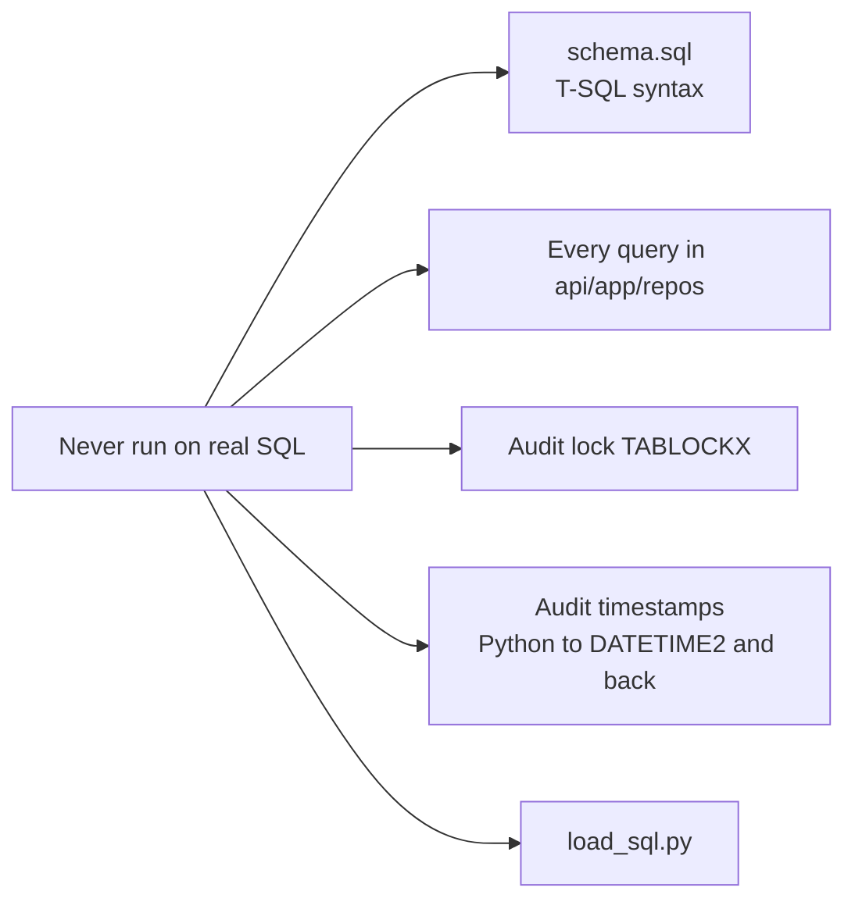
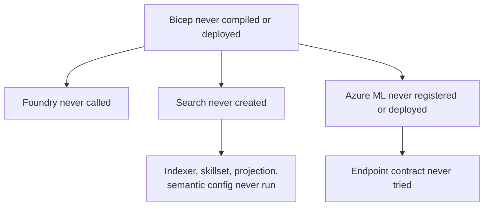
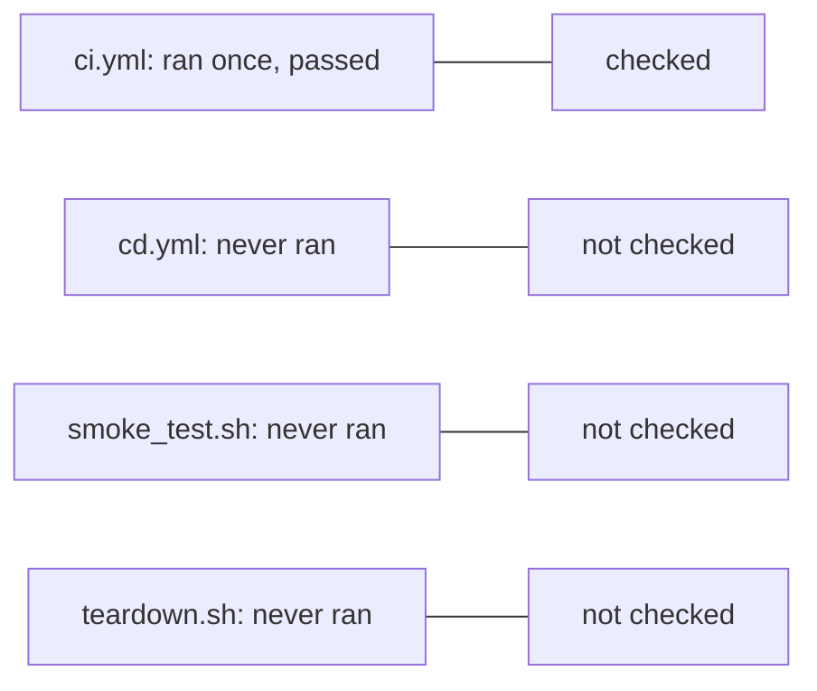
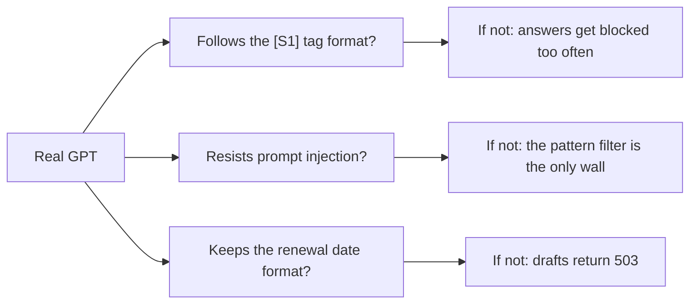
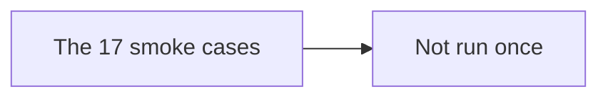
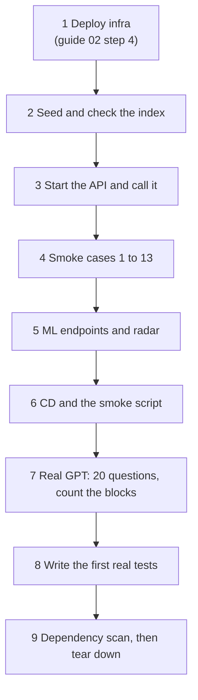

# 04. Testing we have not done

An honest list. Everything below is built but **unproven**. Read it before you trust Saathi.

## The picture

```mermaid
flowchart LR
    subgraph DONE["Checked"]
        D1["Python lint<br/>ruff in CI"]
        D2["Secret scan<br/>gitleaks in CI"]
        D3["Blazor UI compiles<br/>dotnet build in CI"]
        D4["API logic with fake data<br/>51 checks, not saved"]
        D5["Models train and score<br/>on this laptop"]
        D6["Search path with a faked reply"]
    end
    subgraph NOT["Not checked"]
        N1["Real SQL"]
        N2["Real Azure: Bicep, Foundry,<br/>Search indexer, Azure ML"]
        N3["App Service startup"]
        N4["CD and scripts"]
        N5["UI in a browser"]
        N6["Real GPT behaviour"]
        N7["Automated tests: none exist"]
        N8["Load and abuse"]
    end
    DONE --> NOT
```

## What "checked" does and does not mean

| Check | Proves | Does not prove |
|---|---|---|
| ruff, pyflakes | no syntax errors, no unused imports | the code is correct |
| `dotnet build` | the UI compiles | the UI behaves |
| gitleaks | no known secret patterns in the diff | no secret anywhere |
| 51-check simulation (my scratch script, **not in the repo**) | routes, permissions, draft rules, audit chain, grounding and rate limit work on fake in-memory data | any SQL query, any Azure call |
| trained models | training and scoring code runs | the models are good (the intent F1 of 1.000 is inflated by templated data) |

## Not done, by area

### A. Automated tests: none

There are no test files. This was a decision (the engineer owns testing), not an oversight. Nothing re-checks the code after a change except lint and the build.

| Risk | High |
|---|---|
| How to fix | write tests for `safety.py`, `audit.py`, `auth.py` and the draft rules first: they are pure logic and the most important |

### B. Real SQL

| Item | Why it could break | How to test | Look for |
|---|---|---|---|
| Queries | a typo or dialect slip | smoke cases 1 to 13 | a 500 error and the log line |
| `TABLOCKX` on the audit table | blocks readers while a write is open | two people chatting at once | slow or stuck requests |
| Audit hash and `DATETIME2` | a rounding difference makes the chain look tampered | do some actions, then Verify | `broken_at` on an untouched log |
| `load_sql.py` | fails if the tables already hold rows | run it twice | the error on the second run (expected) |

Risk: **high**. Every feature uses SQL.

### C. Real Azure

| Item | Why it could break | How to test | Look for |
|---|---|---|---|
| Bicep | never compiled; API versions or property names may be wrong | guide 02, step 4 | deploy errors |
| Foundry | model name, version, quota, API version | one chat and one embedding call | 503 `service_unavailable` |
| Search indexer | OCR, merge, split, entity and embedding skills; the projection mapping; the semantic configuration | guide 02, step 8 | count not 13; indexer errors |
| `read_hit` naming rule | PDF text may not start with `Clause X (v1)` after extraction | ask a question, read the citations | 503 `search_misconfigured` |
| Azure ML | SDK calls, the model path in the endpoint, the conda environment | guide 02, step 9 | deploy failure; the invoke test returning an error |
| Endpoint request and reply shapes | the API assumes `{text}` and `{rows}` | the invoke test, then the radar panel | radar says unavailable |

Risk: **high**. Most of the product depends on it.

### D. App Service

| Item | Why it could break | How to test | Look for |
|---|---|---|---|
| `startup.sh` | installs the ODBC driver on every start; assumes Debian, `apt-get`, network, and `python -m uvicorn` on the path | deploy and read the log stream | a start that never finishes |
| Key Vault references | the API's identity needs the role before the first start | restart once after the first deploy | settings showing as `@Microsoft.KeyVault(...)` text |
| Zip deploy and the build | requirements install during deploy | the CD run | build errors |
| WebSockets for Blazor | needs to be on | open the web app | a page that loads but does nothing |

### E. Pipelines and scripts

| Item | How to test | Look for |
|---|---|---|
| `cd.yml` | guide 02, step 11 | a failing job; missing secrets |
| `smoke_test.sh` | guide 02, step 12 | a timeout on a cold start |
| `teardown.sh` | run it last, on a throwaway group first | an unpurged Key Vault or Foundry name blocking the next deploy |

### F. The web UI in a browser

It compiles, and nothing more is known. Never opened in a browser.

| Item | Why it could break | How to test |
|---|---|---|
| Login and role routing | state lives in the browser session | guide 03, case 1 and 11 |
| Chat, citation chips, drafts | event handlers and binding | cases 2 to 7 |
| The 5-second refresh | a timer started in the page | watch the supervisor screen |
| Layout on a phone | styles were never looked at | open it on a phone |
| Other browsers | none tried | Chrome, Safari, Firefox |

### G. Real GPT behaviour

The grounding check is strict by design, so a model that writes tags a little differently gets blocked. Try twenty varied questions and count the blocks. If more than a few are blocked for no good reason, loosen the prompt or the check.

### H. Security and abuse

| Item | State | How to test |
|---|---|---|
| Dependency vulnerabilities | never scanned | `pip-audit` on `api/requirements.txt`; `dotnet list package --vulnerable` |
| Injection beyond the pattern list | untested with real attacks | try 30 attacks, with obfuscation |
| Rate limit across restarts and instances | in one process only | restart and retry |
| Login brute force | no limit | not recommended to test on a live site |
| Public demo passcode | `saathi-demo` is public | change it or restrict access before leaving a site running |
| Load | never tried | 20 users chatting at once |

### I. The human run

## Suggested order

If you only have an hour: do steps 1 to 4. That covers the highest risks (B, C, D).

Back to [the root README](../README.md).
