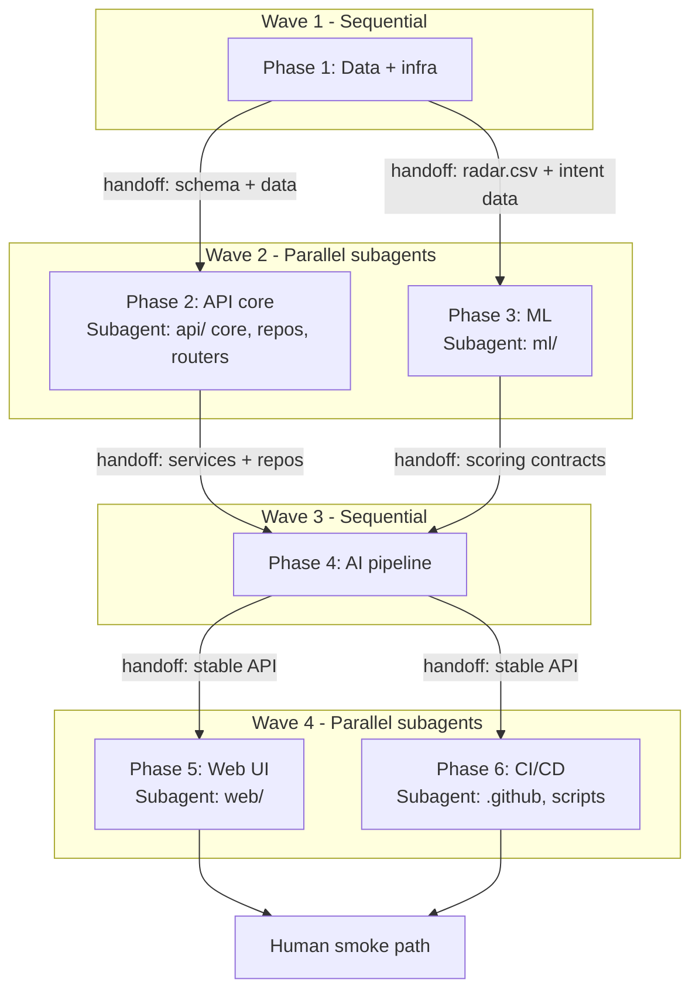
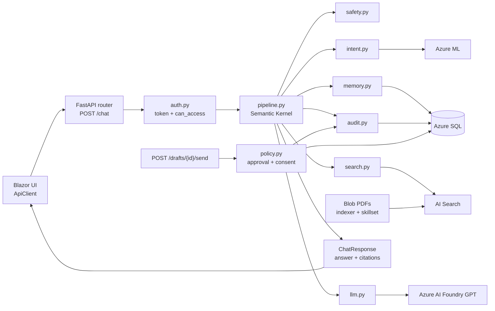

# Saathi MVP plan

Status: approved. Implementation has not started.

## 1. Goal and repositories

**Goal:** Build Saathi from scratch in this repo: an insurance-agent copilot that follows the architecture diagram (Blazor UI -> FastAPI -> Semantic Kernel orchestrator -> Azure AI Foundry, AI Search, SQL, Blob and Azure ML), with cited answers, human-approved drafts and an audit log. Keep it simple, lean and reusable. This is a separate project: a new repo, a new Azure resource group (`saathi-from-scratch-rg`) and new resource names. Nothing is shared with, copied from, or deployed into any earlier Saathi project or Azure resource.

**Repository:** `saathi-from-scratch` (one repo, owned by folder).

| Folder | Owns |
|---|---|
| `api/` | Python FastAPI, Semantic Kernel orchestrator, MCP tools (the AI layer) |
| `web/` | .NET Blazor UI: agent workspace and supervisor console |
| `ml/` | Intent classifier and Renewal Radar (training, scoring, Azure ML deploy) |
| `data/` | Synthetic customers, insurance PDFs, eval questions, seed scripts |
| `infra/` | Bicep for all Azure resources |
| `.github/workflows/` | CI (PRs to main) and CD (deploy on merge) |
| `plans/` | This plan |

Rules: .NET is only the UI. Python owns all AI and data access. Safety lives in code, not prompts. No Docker; hosting is Azure App Service.

## 2. Functional features and exclusions

**MVP (everything in the architecture diagram works end to end):**

- Agent picks a customer, asks a question and gets an answer with citations (source and clause).
- Follow-up questions work without repeating the customer (session memory).
- Each question is classified by intent (ML classifier).
- An agent can only see customers they own and products they are approved for.
- Agent requests a renewal draft; it is PENDING and sending is blocked.
- Agent approves; consent is re-checked; the draft is marked SIMULATED_SENT.
- Every action is written to a tamper-evident audit log; verify finds a tampered row.
- Prompt-injection attempts are blocked and unsupported claims are caught.
- Renewal Radar lists the customers most likely to renew, with reasons (Azure ML).
- An agent tool (`search_knowledge_base`) lets the orchestrator search on demand.
- Supervisor console shows pending drafts, audit log and usage.
- Live on an Azure URL, with CD on merge to `main`.

**Excluded from the MVP:** real message sending, real customer data, Docker, SignalR (the console polls), Entra ID login, translation, interaction summarization, red-team suite, fairness report, Mini Transformer notebook, Copilot usage log.

## 3. Models

All models are `#NEW`. Tables live in Azure SQL, created by `data/seed/sql/schema.sql`, with one repo file per table in `api/app/repos/`.

```text
Azure SQL

agents                      #NEW  agent_id, name, role (agent|supervisor), products[], passcode_hash
├── auth.py                 #READ    verify identity and passcode hash, role, product scope
└── seed                    #WRITE   demo agents (sha256 hash of the shared demo passcode `saathi-demo`)

customers                   #NEW  customer_id, agent_id (owner), name, phone, language,
│                                 consent (bool), consent_updated_at
├── customers router        #READ    list/get only owned customers
├── policy.py               #READ    consent check before send
└── seed                    #WRITE

policies                    #NEW  policy_id, customer_id, product, tier,
│                                 annual_premium_inr, renewal_date, status
├── radar service           #READ    features for renewal prediction
└── pipeline                #READ    customer context for answers

interactions                #NEW  interaction_id, customer_id, date, channel, text
├── pipeline                #READ    context for answers
└── seed                    #WRITE

sessions                    #NEW  session_id, agent_id, customer_id, summary
turns                       #NEW  turn_id, session_id, role, text, citations, ts
├── memory.py               #READ    last 6 turns + summary
├── memory.py               #WRITE   append turn
└── memory.py               #MODIFY  update rolling summary

drafts                      #NEW  draft_id, customer_id, agent_id, text, citations,
│                                 status (PENDING|APPROVED|SENT), approved_by, ts
├── drafts router           #WRITE   create PENDING
├── drafts router           #MODIFY  approve, then mark SENT
└── supervisor console      #READ    list pending

audit_events                #NEW  id, ts, actor, type, payload, prev_hash, hash
├── audit.py                #WRITE   append only (no update, no delete)
└── audit router            #READ    list, verify chain

Azure AI Search

index: policy_chunks        #NEW  chunk_id, parent_id, doc, text, entities, vector
├── indexer (Blob)          #WRITE   built from PDFs by the skillset (OCR, merge, split, entity recognition of amounts and periods, embed)
└── search.py               #READ    hybrid + semantic query

Azure ML (registered models)

intent-classifier           #NEW  #READ by intent.py
renewal-radar               #NEW  #READ by radar.py
```

Notes:
- `audit_events` is append-only; each row stores the previous row's hash.
- Consent lives on `customers` and gates sending only, not scoring or visibility.
- Agent-to-customer ownership is the single `customers.agent_id` column.
- Renewal status (ACTIVE, IN_GRACE, LAPSED) is computed in code from `renewal_date`, not stored.
- Audit event types: `login`, `login_failed`, `customer_viewed`, `draft_created`, `draft_approved`, `draft_sent`, `send_blocked`; Phase 4 adds `chat` and `chat_blocked`, which `/usage` counts.

## 4. File tree

Everything is `#NEW` (empty repo; the old project is reference only).

```text
saathi-from-scratch/
├── README.md                          #NEW — title, description, architecture image
├── .env.example                       #NEW — every env var, names only
├── Makefile                           #NEW — dev, test, seed, deploy shortcuts
├── api/
│   ├── pyproject.toml                 #NEW — ruff config
│   ├── requirements.txt               #NEW — deps for App Service
│   ├── startup.sh                     #NEW — installs the ODBC driver, then starts uvicorn
│   └── app/
│       ├── main.py                    #NEW — app factory, router wiring, error shape
│       ├── config.py                  #NEW — typed settings, one place
│       ├── deps.py                    #NEW — settings, DB connection, logged-in agent
│       ├── models/                    #NEW — Pydantic shapes: errors, auth, customer, draft, citation, audit, chat, radar
│       ├── repos/                     #NEW — SQL: db helpers, agents, customers, sessions, drafts, audit
│       ├── routers/
│       │   ├── health.py              #NEW — GET /health
│       │   ├── access/                #NEW — auth.py (login), audit.py (log, verify, usage)
│       │   ├── customers/             #NEW — customers.py, radar.py (worklist)
│       │   ├── drafts/                #NEW — drafts.py (create, list, approve, send)
│       │   └── chat/                  #NEW — chat.py (POST /chat, GET /sessions/{id})
│       ├── services/
│       │   ├── access/                #NEW — auth.py (identity, tokens, access), audit.py (hash chain)
│       │   ├── customers/             #NEW — renewal.py (renewal state), radar.py (worklist scoring)
│       │   ├── drafts/                #NEW — rules.py (send rules), writer.py (LLM-polished draft)
│       │   ├── chat/                  #NEW — intent.py, memory.py, safety.py
│       │   └── ai/                    #NEW — client.py (Azure calls), llm.py (Foundry), search.py (AI Search)
│       └── orchestrator/              #NEW — pipeline.py (step order), tools.py (search_knowledge_base)
├── web/
│   └── Saathi.Web/
│       ├── Saathi.Web.csproj          #NEW — .NET 10 Blazor Server project
│       ├── Program.cs                 #NEW — reads API_URL, registers ApiClient and AuthState
│       ├── appsettings.json           #NEW — logging only (API_URL comes from the environment)
│       ├── App.razor                  #NEW — the HTML page, interactive server mode without prerendering
│       ├── Routes.razor               #NEW — URL to page
│       ├── _Imports.razor             #NEW — shared namespaces
│       ├── Layout/                    #NEW — MainLayout.razor (title bar, log out)
│       ├── Pages/
│       │   ├── Login/                 #NEW — LoginPage.razor
│       │   ├── Workspace/             #NEW — WorkspacePage.razor (the agent screen)
│       │   └── Supervisor/            #NEW — SupervisorPage.razor (polls every 5 seconds)
│       ├── Components/
│       │   ├── ApiComponent.cs        #NEW — base class: runs an API call and keeps its error
│       │   ├── Customers/             #NEW — CustomerList.razor, RadarPanel.razor
│       │   ├── Chat/                  #NEW — ChatPanel.razor (with citation chips)
│       │   ├── Drafts/                #NEW — DraftCard.razor
│       │   └── Supervisor/            #NEW — PendingDrafts.razor, AuditPanel.razor, UsagePanel.razor
│       ├── Services/                  #NEW — ApiClient.cs (every API call), AuthState.cs, ApiModels.cs
│       └── wwwroot/                   #NEW — app.css
├── ml/
│   ├── requirements.txt               #NEW — scikit-learn, joblib, azure-ai-ml (pinned to match the endpoints)
│   ├── intent/                        #NEW — train.py, score.py
│   ├── radar/                         #NEW — train.py, score.py (features and top factors)
│   └── azureml/
│       ├── scripts/                   #NEW — register.py, deploy.py, score_intent.py, score_radar.py
│       └── config/                    #NEW — conda.yml for the endpoints
├── data/
│   ├── generate.py                    #NEW — seeded synthetic customers
│   ├── requirements.txt               #NEW — packages for the data scripts
│   ├── docs/
│   │   ├── pdf/                       #NEW — insurance clause PDFs
│   │   └── json/                      #NEW — manifest.json describing each PDF
│   ├── eval/                          #NEW — gold questions for evaluation
│   └── seed/
│       ├── json/                      #NEW — agents, customers, policies, interactions
│       ├── csv/                       #NEW — intent and radar training data
│       ├── sql/                       #NEW — schema.sql
│       └── scripts/                   #NEW — load SQL, upload Blob, create index
├── infra/
│   ├── bicep/
│   │   ├── main.bicep                 #NEW — all Azure resources
│   │   └── modules/                   #NEW — one file per service
│   └── params/
│       └── parameters.json            #NEW — names, SKUs, region
├── scripts/                           #NEW — smoke_test.sh (post-deploy check), teardown.sh (delete everything)
├── public/
│   └── architecture.png               #REUSED — already committed; README architecture image
├── .github/workflows/
│   ├── ci.yml                         #NEW — PRs to main: ruff, dotnet build, secret scan (no tests)
│   └── cd.yml                         #NEW — merge or manual run: zip deploy API and web, then smoke check
└── plans/
    └── saathi-mvp.md                  #NEW — this plan
```

## 5. Routes and API contracts

All routes are `#NEW`; none are removed. Every error returns `{"error": {"code", "message"}}`.

| Method | Path | Auth | Request | Success | Failures |
|---|---|---|---|---|---|
| GET | `/health` | none | none | 200 `{status}` | none |
| POST | `/auth/login` | none | `{agent_id, passcode}` | 200 `{token, name, role}` | 401 |
| GET | `/customers` | agent | none | 200 `[{customer_id, name, language, consent, renewal_status}]` (own only) | 401 |
| GET | `/customers/{id}` | agent | none | 200 `{customer, policies[], interactions[]}` | 401, 403, 404 |
| POST | `/chat` | agent | `{customer_id, session_id?, question}` | 200 `{session_id, answer, citations[{source_id, clause_id, version}], intent{label, confidence}, blocked, reason?}` | 400, 401, 403, 404, 503 |
| GET | `/sessions/{id}` | agent | none | 200 `[{role, text, citations, ts}]` | 401, 403, 404 |
| POST | `/drafts` | agent | `{customer_id, session_id?}` | 201 `{draft_id, text, citations, status: "PENDING"}` | 401, 403, 404, 503 |
| GET | `/drafts?status=` | supervisor | none | 200 `[draft]` | 401, 403 |
| POST | `/drafts/{id}/approve` | owner or supervisor | none | 200 `{draft_id, status: "APPROVED", approved_by}` | 401, 403, 404, 409 |
| POST | `/drafts/{id}/send` | owner or supervisor | none | 200 `{draft_id, status: "SIMULATED_SENT"}` | 401, 403 (consent missing), 404, 409 (not approved) |
| GET | `/radar/worklist` | agent | none | 200 `[{customer_id, name, days_to_renewal, score, top_factors[], status}]` (own, eligible only) | 401, 503 |
| GET | `/audit` | supervisor | none | 200 `[{id, ts, actor, type, payload, hash}]` | 401, 403 |
| GET | `/audit/verify` | supervisor | none | 200 `{valid, broken_at, count}` | 401, 403 |
| GET | `/usage` | supervisor | none | 200 `{chats, blocked, drafts_by_status}` | 401, 403 |

Phase 2 notes: `GET /drafts` requires the `status` query parameter. `POST /drafts` takes only `customer_id` until Phase 4 uses `session_id` for LLM context, and until then draft text comes from a fixed template. A supervisor may open any customer. Customer list and detail calls are audited as `customer_viewed`.

Phase 3 and 4 notes:
- Clause ids start with their product (`HEALTH-`, `MOTOR-`, `TERM-`). The product limit is applied in `search.py` after the search returns, before anything reaches the model.
- The pipeline is plain Python in a fixed order, not Semantic Kernel. `tools.py` defines `search_knowledge_base` with an MCP-style JSON schema, an allowlist and a limit of 3 calls per request; a Semantic Kernel or MCP wrapper can be added later.
- An agent question with the intent `other` (a greeting) gets a fixed reply and skips search and GPT.
- A blocked question or answer returns `blocked: true` with a reason and is audited as `chat_blocked`. Blocked turns are not remembered. A failed Azure call is audited as `chat_failed` and returns 503.
- Memory keeps the last 6 turns. The rolling summary is not generated yet.
- Drafts: the LLM polishes a fixed message and may cite policy rules. The draft is rejected (503) if the real renewal date is missing from it.
- `ML_PROVIDER=local` and `LLM_PROVIDER=mock` use small stand-ins (word rules, a formula, a canned reply), so the API runs offline. The trained models are used through the Azure ML endpoints.
- Azure ML endpoint contract. Intent: `{text}` returns `{label, confidence}`. Radar: `{rows}` returns `{results: [{customer_id, score, top_factors}]}`.
- The Azure ML scripts need `AZURE_SUBSCRIPTION_ID`, `AZURE_RESOURCE_GROUP` and `AZURE_ML_WORKSPACE`.

Decisions: login checks the seeded demo agents' passcode hash and returns a signed token (no Entra ID). The supervisor console polls `/drafts`, `/audit` and `/usage` instead of using SignalR. 403 means wrong owner or role, 409 means the draft is in the wrong state, 503 means an Azure dependency failed.

## 6. Services and validation

| Owner | Function | Arguments | Return | Side effects | Callers |
|---|---|---|---|---|---|
| `auth.py` | `login` / `current_agent` / `can_access(agent, customer)` | credentials / token / ids | token / `Agent` / bool | none | auth router, `deps.py`, every router |
| `intent.py` | `classify(text)` | question | `{label, confidence}` | Azure ML call, local fallback | `pipeline` |
| `memory.py` | `load(session_id)` / `append(...)` / `summarize(...)` | session, turn | last 6 turns + summary | SQL write | `pipeline` |
| `search.py` | `retrieve(query, product, k)` | text, filters | `[Chunk{text, source_id, clause_id, version}]` | AI Search call | `pipeline`, `tools` |
| `llm.py` | `generate(prompt, context)` | text | answer text | Foundry call | `pipeline`, `drafts` |
| `safety.py` | `check_input(text)` / `filter_chunks(chunks)` / `check_grounding(answer, chunks)` | text / chunks / answer | pass or reason | none | `pipeline` |
| `policy.py` | `can_send(draft, customer)` | draft, customer | allowed or reason | none | drafts router |
| `radar.py` | `worklist(agent)` | agent | `[RadarRow]` (eligible only) | Azure ML call, local fallback | radar router |
| `audit.py` | `log(event)` / `verify()` | event | event / `{valid, broken_at, count}` | SQL append | every router, `pipeline` |
| `pipeline.py` | `answer(agent, customer_id, session_id, question)` | ids, text | `ChatResponse` | calls the services above in order | chat router |
| `tools.py` | MCP tools (`search_knowledge_base`) | JSON-schema args | tool result | at most 3 calls per request | `pipeline` |

**Pipeline order, strictly:** input safety -> authorize -> classify -> memory -> retrieve -> generate -> ground -> audit. A failed check returns `blocked: true` with a reason and still writes an audit event.

**Validation and rules**
- **Auth:** token on every route except `/health` and `/auth/login`. Customer routes check `can_access`; supervisor routes check the role.
- **Input:** Pydantic models on every request. A question must be 1 to 1000 characters; empty or oversized input returns 400.
- **Answers:** every claim must carry a citation. If grounding fails the answer is blocked, never patched.
- **Drafts:** create is PENDING. Approve is allowed only from PENDING and send only from APPROVED, otherwise 409. Send re-checks consent. A repeated send returns 409 and sends nothing twice.
- **Retrieved text:** chunks containing injection patterns are dropped before generation.
- **Errors:** an Azure failure returns 503 and writes an audit event. The system never answers without sources.
- **Logging:** names, phones and emails are redacted from logs; audit payloads store IDs, not raw personal data.
- **Local mode:** the AI services (LLM, search, ML) each have a mock selected by an env var. Azure SQL has no mock: the API always needs `SQL_CONNECTION_STRING`.

## 7. Environment variables

The repo is public: `.env.example` lists names only; real values live in Key Vault or GitHub secrets. Local runs need no Azure AI variables because the AI services have mocks. The API always needs a SQL database. Minimum for local: `APP_ENV=local`, `JWT_SECRET`, `SQL_CONNECTION_STRING`, and the three mode switches set to `mock` or `local`.

| Group | Variable | Purpose |
|---|---|---|
| App | `APP_ENV` | `local` or `azure` |
| App | `JWT_SECRET` | signs login tokens |
| App | `API_URL` | the UI's backend URL |
| Mode | `LLM_PROVIDER` | `mock` or `azure` |
| Mode | `RETRIEVER` | `local` or `azure` |
| Mode | `ML_PROVIDER` | `local` or `azure` |
| Foundry | `AZURE_OPENAI_ENDPOINT` | resource URL |
| Foundry | `AZURE_OPENAI_API_KEY` | key (Key Vault in Azure) |
| Foundry | `AZURE_OPENAI_CHAT_DEPLOYMENT` | GPT deployment name |
| Foundry | `AZURE_OPENAI_EMBED_DEPLOYMENT` | embedding deployment name |
| AI Search | `AZURE_SEARCH_ENDPOINT` | service URL |
| AI Search | `AZURE_SEARCH_ADMIN_KEY` | key |
| AI Search | `AZURE_SEARCH_INDEX_NAME` | index name |
| SQL | `SQL_CONNECTION_STRING` | connection string |
| Blob | `AZURE_STORAGE_CONNECTION_STRING` | PDF upload and indexer data source |
| Azure ML | `RADAR_ENDPOINT_URL`, `RADAR_ENDPOINT_KEY` | Renewal Radar endpoint |
| Azure ML | `INTENT_ENDPOINT_URL`, `INTENT_ENDPOINT_KEY` | intent classifier endpoint |
| CD only | `AZURE_CREDENTIALS` | service principal (GitHub secret) |
| CD only | `AZURE_WEBAPP_NAME_API`, `AZURE_WEBAPP_NAME_WEB` | the two App Service names (GitHub secrets) |

## 8. E2E smoke path

E2E smoke testing is human-only. This section is instructions for the engineer; no agent or subagent runs these cases or reports their result.

Seed: every demo agent uses the passcode `saathi-demo`. Demo agents (one agent who owns C-204 and C-311, a second agent who owns C-118, one supervisor) and the six synthetic customers, with C-205 set to `consent=false`.

| # | Setup | Action | Expected API / database | Expected UI |
|---|---|---|---|---|
| 1 | Seeded data, API running | Log in as the owning agent | 200 with token, name, role | Workspace opens |
| 2 | Logged in as owner | Select C-204, ask "Compare Silver and Gold" | 200 with answer and citations (source_id, clause_id); audit event written | Answer shown with citation chips |
| 3 | Same session | Ask "and Platinum?" | 200 using session memory; customer not repeated | Follow-up answered correctly |
| 4 | Owner | Request a renewal draft | 201 `PENDING`; draft row stored | Draft card shows pending approval, Send disabled |
| 5 | Pending draft | Call send before approve | 409 not approved; no status change | Error message shown |
| 6 | Pending draft | Approve, then send | 200 `APPROVED`, then 200 `SIMULATED_SENT`; audit events | Draft shows sent |
| 7 | C-205 (`consent=false`) | Approve then send | 403 consent missing; not sent | Send blocked with reason |
| 8 | Agent 1 logged in | Open C-118 (owned by agent 2) | 403; no data returned | Access denied |
| 9 | Owner | Send an injection prompt | 200 `blocked=true` with reason; audit event | Blocked message shown |
| 10 | Owner | Send an empty question, then a 1000+ character one | 400 each | Validation message |
| 11 | Supervisor | Open `/radar/worklist`, `/drafts`, `/usage` | 200 lists; only eligible customers in worklist | Console panels load |
| 12 | Supervisor | Run audit verify | 200 `valid=true` | Chain shown valid |
| 13 | After case 12 | Change one `audit_events` row directly in SQL, verify again | 200 `valid=false` with `broken_at` | Chain shown invalid at that event |
| 14 | Foundry or Search disabled | Send a chat question | 503; audit event; no unsourced answer | Service-unavailable message |
| 15 | Deployed Azure URL | `GET /health` | 200 | n/a |

## 9. Phases and agent orchestration

Verification is part of each phase; there is no separate verification phase.

| Phase | Outcome | Prerequisites | Verification |
|---|---|---|---|
| Phase 1 — Data + infra | `schema.sql`, seeded synthetic data, insurance PDFs, gold evaluation questions, Bicep for all Azure resources | none | Data seeds into SQL; `az deployment` validates; PDFs upload |
| Phase 2 — API core | config, models, repos, auth, audit, policy, memory, and the health, auth, customers, drafts and audit routers | Phase 1 | App imports and serves the routes in the plan; engineer runs the smoke cases that apply |
| Phase 3 — ML | Intent classifier and Radar trained, scoring code, Azure ML deploy scripts | Phase 1 | Scoring code returns the agreed fields; endpoints answer a sample request |
| Phase 4 — AI pipeline | llm, search, safety, intent/radar clients, orchestrator, MCP tools, chat and radar routers | Phases 2 and 3 | Injection and grounding cases are blocked in the smoke path |
| Phase 5 — Web UI | Blazor login, agent workspace (customers, radar, chat, drafts) and supervisor console, one `ApiClient` | Phase 4 | `dotnet build` passes; UI works against the API in the smoke path |
| Phase 6 — CI/CD | `ci.yml`, `cd.yml`, `smoke_test.sh`, `teardown.sh`, ODBC install in `startup.sh` | Phase 4 | CI green on a PR; CD deploys to App Service and the smoke check passes |

## Agent orchestration

- Phases 2 and 3 only need the schema and data from Phase 1, so they run in parallel.
- Phase 4 calls both the API core and ML scoring, so it waits for both.
- Phases 5 and 6 each need only the finished API, so they run in parallel.
- The smoke path (section 8) is run by the engineer after Wave 4.



Subagent boundaries: each owns only its folders (listed above) and hands back the files changed and the test results. Subagents do not touch each other's folders.

## 10. Assumptions, risks, compatibility and locked decisions

**Assumptions**
- The Azure subscription has quota for a GPT deployment, an embedding deployment and an Azure ML online endpoint in the chosen region.
- Everything is created fresh in its own resource group. No resource from any earlier Saathi project is reused.
- All data is synthetic; nothing real is stored or sent.

**Risks**
- Model or ML endpoint quota can fail in a region. Mitigation: fix in the portal and note it in the README; every service has a mock so local work continues.
- The repo is public. No secrets, keys or real data may be committed.
- Azure ML endpoints bill while running. Mitigation: a teardown script, and delete the endpoints after the demo.

**Known limitations** (built so far, phases 1 to 4)

*Not verified yet*
- The Blazor UI has never been compiled or run: `dotnet` was not available when it was written. The first `dotnet build` is the CI job, so expect small fixes.
- The CI and CD workflows have never run on GitHub. CD fails until the secrets `AZURE_CREDENTIALS`, `AZURE_WEBAPP_NAME_API` and `AZURE_WEBAPP_NAME_WEB` exist and `make deploy-infra` has created the resources.
- Nothing has run against real Azure: SQL, Foundry, AI Search and Azure ML. The Bicep has never been compiled or deployed, and the Azure ML register and deploy scripts are unverified.
- The API reads a search result's clause id and product from its file name (`health-silver-01.pdf` is clause `HEALTH-SILVER-01`, product `health`) and its version from the `(v1)` in the clause text. A new clause PDF must follow that naming, or its results are rejected with a 503. This needs only the file name and text, which the indexer always provides.
- `startup.sh` installs the ODBC Driver 18 for SQL Server on every cold start. This assumes the App Service image is Debian with `apt-get` and network access, and it has not been tried on a real App Service.
- The human E2E smoke path has not been run.

*Security*
- Passcodes are unsalted sha256, which is fine for synthetic demo agents but not for real credentials.
- The audit chain is not keyed, so someone with database write access could rewrite the whole chain consistently. It also cannot detect removal of the newest rows.
- There is no login rate limit, no per-agent rate limit on `/chat` (each call costs an LLM request), and tokens last 8 hours with no revocation.
- Prompt-injection detection is a pattern list, a first line of defence next to the grounding check. Azure Search uses the admin key at runtime.

*Behavior*
- The grounding check is strict by design. An answer that does not end each sentence with a source tag is blocked, and a draft without the real renewal date is rejected. Real GPT may be refused more often than expected.
- The pipeline is plain Python, not Semantic Kernel, and `tools.py` only has the MCP-style schema. Memory keeps the last 6 turns with no rolling summary.
- `ML_PROVIDER=local` and `LLM_PROVIDER=mock` are stand-ins (word rules, a formula, a canned reply). The mock GPT answers from the first source, so a follow-up repeats the first answer. SQL has no mock.
- The intent model's F1 of 1.000 is inflated because the synthetic questions share templates. Radar test ROC-AUC is 0.82.
- A chat asking to "draft a reminder" goes through search and is usually blocked; the agent should use the draft button.
- Sending a draft and logging it are two separate commits, so a crash between them leaves a sent draft with no audit row.

*Behavior of the UI*
- A page refresh logs the user out. The supervisor screen polls every 5 seconds, so it reloads all three panels each time.
- Phase 5 has no screen for one customer's policies or interaction history, and no way to open an old session.

*Scale*
- Customer lists run one policy query per customer, `/audit` returns the newest 200 events, and `load_sql.py` only works on a fresh database. Fine at demo scale.

**Compatibility:** greenfield repo, no migration. The schema is created by `schema.sql`.

**Locked decisions**
- Separate project: new repo, new resource group, new resource names (prefix `saathifs`).
- Single repo, split by folder; .NET is UI only; Python owns AI and data.
- No Docker; Azure App Service with zip deploy.
- Bicep for infrastructure.
- Login with a signed token for seeded demo agents (no Entra ID).
- Supervisor console polls (no SignalR).
- Client code lives in `Saathi.Web` as one `ApiClient`.
- The UI is Blazor Server with one `AuthState` per browser session, so a page refresh logs the user out. The token never reaches the browser.
- The web App Service has WebSockets on, and the API startup runs as `bash startup.sh`.
- Every Azure service has a mock selected by an env var.
- Audit log is append-only and hash-chained.
- Smoke testing is human-only.

## 11. Request flow



## 12. Code standards (guardrail)

These apply to every phase and are part of the quality audit before any PR.

- **File comment:** every file that can hold comments starts with a comment saying what the file is responsible for. JSON, CSV, PDF and image files are exempt.
- **Function comment:** every function has a comment directly above it saying what it does, in plain words.
- **Simple code:** write it the way a junior engineer (SDE-1) would read and maintain it. Straight-line logic, plain loops, clear names. No clever one-liners, no metaprogramming, no deep nesting.
- **Minimal code:** no helper, wrapper, class, file or dependency unless it removes real duplication or the plan requires it.
- **No fallbacks:** no default parameter values, `or` defaults, catch-all fallbacks or silent recovery unless the plan says so. Missing config fails loudly.
- **Reuse first:** use an existing function, model or component before adding a new one.
- **Audit:** the quality audit checks every item above, and a failure blocks the PR.
- **Folder layout:** inside a folder, files of different formats go in format subfolders (`json`, `csv`, `sql`, `scripts`, `pdf`, `bicep`).
- **Tests:** the engineer owns all testing. The implementing agent does not write, change or run test files, so the tree has no `tests/` folders.
